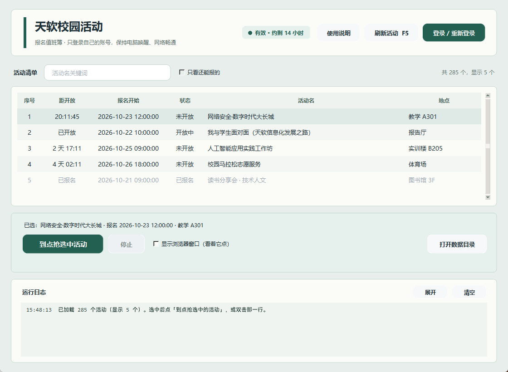

# 智慧元小元 · 校园活动推送机器人

> 天津软件学院（专升本）学生端 `xg.tjise.edu.cn` 的活动，自动整理后推送到飞书；可以 @ 机器人查询，可以在私聊点「预报名」到点自动报名。

[](https://github.com/ShenTingBai/tjise-activity-watch/releases)
[](LICENSE)




> **适用对象**：天津市大学软件学院（天软）**专升本**学生。项目按该校学生端的接口与页面写死；换学校要改 `SCHOOL_ORIGIN` 与接口适配，不在支持范围内。
> **不适用范围**：不代他人报名、不多账号批量占位、不抢别人的名额。

## 目录

- [这是什么](#这是什么)
- [我该用哪个](#我该用哪个)
- [快速开始 · 本机版](#快速开始--本机版5-分钟)
- [快速开始 · 服务器版](#快速开始--服务器版15-分钟)
- [功能](#功能)
- [两版对照](#两版对照)
- [飞书机器人怎么建](#飞书机器人怎么建)
- [配置](#配置)
- [常见问题](#常见问题)
- [目录结构](#目录结构)
- [文档](#文档)
- [边界与安全](#边界与安全)
- [License](#license)

## 这是什么

学校学生端每天挂着各种「校园活动」：有的要卡点抢报名，有的报名了但时间在几天后容易忘。这个项目做两件事：

1. **盯**：定时把「今天要参加的」「即将开放报名的」整理成卡片，推到飞书群，人手一份。
2. **抢**：开放报名的那一刻自动点「立即报名」，结果回执发到私聊。

登录态寿命不稳定：实测 10.7～17.5 小时。服务器版用守护进程每 2 小时续一次，用到 8 小时主动换新；真失效了用验证码 OCR 无人值守重登，连续失败再私聊告警。

## 我该用哪个

| 你的情况 | 用这个 | 需要什么 |
|---|---|---|
| 只想抢某一两场，不想维护服务器 | [本机版](#快速开始--本机版5-分钟)（`local/` / Release 绿色版） | 一台 Windows，双击就能跑 |
| 想让群里同学都能看推送，还想 @ 查询 | [服务器版](#快速开始--服务器版15-分钟)（`server/`） | 一台 7×24 Linux + 飞书自建应用 |

两版共用同一套接口知识，抢报名时序完全一致（提前开详情页 → 开放前 reload → 点按钮 → 读返回码 → 复核结果）。

## 快速开始 · 本机版（5 分钟）

**不想装 Python**：下 [绿色版](https://github.com/ShenTingBai/tjise-activity-watch/releases)，解压双击 `启动.bat`。

**装了 Python**：

```bash
git clone -b local https://github.com/ShenTingBai/tjise-activity-watch.git
cd tjise-activity-watch
```

1. 双击 `install.bat`：安装 Playwright、Pillow、pywebview，并准备浏览器（只第一次）
2. 双击 `1-登录.bat` 或在图形界面点「登录」：弹出真实 Chrome，手动登录一次，登录态存本地
3. 双击 `4-图形界面.bat`：筛选活动并勾选多场，点「开始报名计划」
4. 计划按报名开放时间分批执行；同一开放时刻的非冲突活动并发提交，每场结果独立显示

> 登录只做一次，token 大约能撑 17 小时；失效了再点一次「登录 · 重新登录」。
> 工具只有命令行和 GUI，没有密码落盘，也不会动你浏览器里的账号。

本机 GUI 现在是一张报名时间队列：可以按关键词、报名状态、开放时间、排序方式以及“是否要求签到/签退”筛选。活动的报名开放时间只决定提交批次，活动举办起止时间独立用于冲突检查；缺少签到/签退字段时显示为未知，不会误判成无需。

## 快速开始 · 服务器版（15 分钟）

前置：Ubuntu 22.04 / root / 能访问学校站点与 `open.feishu.cn`。

```bash
# 1) 依赖
apt install -y python3 cron tesseract-ocr
cd /tmp && curl -fsSLO https://npmmirror.com/mirrors/node/v20.20.2/node-v20.20.2-linux-x64.tar.xz \
  && tar -xJf node-v20.20.2-linux-x64.tar.xz -C /usr/local --strip-components=1

# 2) 目录
mkdir -p /root/tjise-activity-watch /root/tjise-bot /root/tjise-login

# 3) 代码
git clone -b server https://github.com/ShenTingBai/tjise-activity-watch.git /root/tjise-activity-watch
```

4. **建飞书机器人** → 跟着 [docs/FEISHU_BOT.md](docs/FEISHU_BOT.md) 走（两条路线：只推送 / 全功能）
5. **填配置** → [docs/CONFIG.md](docs/CONFIG.md)：`server/config.json` + systemd 环境变量
6. **装服务与定时任务** → [docs/OPERATIONS.md](docs/OPERATIONS.md)：3 个 systemd 单元 + 9 条 cron
7. **验证**：

```bash
cd /root/tjise-activity-watch
python3 scripts/selfcheck.py          # 凭据/锁/卡片自检
python3 scripts/run.py --dry          # 看这一轮会推什么（不发）
python3 scripts/run.py --force        # 真推一次
```

群里收到卡片就说明通了。之后每天四个时点自动推送，登录态自己续。

## 功能

| 能力 | 从哪触发 | 说明 |
|---|---|---|
| 定时日报 | cron 07:00 / 10:30 / 16:30 / 21:30 | 先推群卡片，再给 owner 私发带「预报名」按钮的卡片 |
| 群里 @ 查询 | 飞书群 @机器人 | 待开放 / 已开放 / 全部活动，卡片回复 |
| 私人提醒 | cron 07:05 | 只发 owner 私聊：今天要参加的活动 |
| 预报名 | 私聊卡片按钮 | 点一下排队，可再点「取消预报名」 |
| 到点抢报名 | watchlist_runner（每分钟） | 到开放时刻自动点「立即报名」并私聊回报 |
| 本机多活动计划 | `local/app.py` 图形界面 | 多选活动、跨批次等待、同批非冲突并发、逐场取消和整计划停止 |
| 登录态续期 | tjise-login 守护进程 | 每 2 小时校验一次，成功即刷新会话文件 |
| 失效重登 | tjise-autologin.timer（每 5 分钟） | 探针判失效才动作；用满 8h 主动换新；验证码 OCR（ddddocr 主 + Tesseract 兜底），最多 5 次、间隔 30 秒 |
| 监控告警 | token 探针 / 出网自检 | 连续 2 次失败才私聊告警，同一失效周期只提醒一次 |

## 两版对照

| | 服务器版 `server/` | 本机版 `local/` |
|---|---|---|
| 跑在哪 | 一台常驻 Linux（systemd + cron） | 自己电脑，用的时候才开 |
| 登录 | 无人值守：探针判失效 → 验证码 OCR 重登，5 次失败私聊告警（30 分钟后下一轮继续试） | 手动弹真实 Chrome 登录一次，token 存本地 |
| 能力 | 定时日报、群 @ 查询、私聊预报名、到点自动报名、失效重登、断网自检 | 多活动报名计划、活动时段冲突检查、签到/签退要求筛选、图形界面 |
| 依赖 | Python + Node 20 + Chromium + ddddocr + Tesseract + cron | Python + Playwright（或本机 Chrome） |
| 适合 | 7×24 盯着，群里同学都能看 | 只想抢某一两场，不想维护服务器 |

## 飞书机器人怎么建

一句话：**只想推送**用群自定义机器人（webhook，2 分钟）；**要 @ 查询和私聊预报名**必须建企业自建应用（长连接，约 30 分钟）。完整步骤、权限清单、事件订阅、`chat_id`/`open_id` 怎么拿、错误码对照，全在 [docs/FEISHU_BOT.md](docs/FEISHU_BOT.md)。

最容易踩的三个坑：

1. 事件订阅选成「发送到开发者服务器」而不是「长连接」→ 永远收不到消息
2. 权限开了但没「发布版本」并过审 → 一条消息都发不出去
3. `PRIVATE_OWNER_OPEN_ID` 与 `bot/data/users.json` 里的记录对不上 → 私聊静默关闭

## 配置

所有可调项（10 个 config 键 + 13 个环境变量 + 三套可抄示例）见 [docs/CONFIG.md](docs/CONFIG.md)。

```bash
cp server/config.example.json server/config.json   # 再填 webhook / 应用凭据
```

`config.json` 含密钥，已在 `.gitignore` 中，**不要提交**。

## 常见问题

**Q：抢报名会不会被学校查到/封号？**
只操作你自己的账号、只在开放时刻点一次、不批量。请求量和人工点几下差不多（每天约 400 次业务接口，含 288 次带 token 的探针）。

**Q：推送没样式，是一段纯文本？**
飞书整点会限流（`11232`），代码已重试 1.5/3/6 秒；仍失败会退回纯文本。错峰或等下一轮即可。

**Q：登录态多久过期？**
实测 10.7～17.5 小时（不稳定，最短那次只活了 10 小时 40 分）。服务器版用到 8 小时主动换新，避免失效后 15-20 分钟的盲窗。

**Q：验证码识别率多少？**
20 张人工标注样本：ddddocr beta 模型 19/20，默认模型 16/20，Tesseract 多变体投票 14/20，三者串联 20/20。每次失败隔 30 秒再换一张、最多 5 次；仍失败会私聊喊你人工登一次。

**Q：私聊一条都收不到？**
先查 `data/remind.log` 有没有 `[i] 未配置 PRIVATE_OWNER_OPEN_ID`；再对照 [docs/CONFIG.md](docs/CONFIG.md) 的四条判据。

**Q：能给我舍友的账号也抢吗？**
不能。多账号批量报名属于占位，会损害其他同学，也容易触发平台风控。本机版给舍友自己跑，各自抢各自的。

## 目录结构

```
tjise-activity-watch/
├── server/        # 服务器版：scripts/（生产脚本）bot/（飞书机器人）deploy/（systemd、登录）tests/
├── local/         # 本机版：app.py + grab.py + signup_plan.py + ui/ + 打包入口
├── docs/          # 架构、运维、登录、抢报名、时点推导、飞书机器人、配置
├── tools/         # 发版工具（拆分支、打 zip、发 Release）
└── README.md / CHANGELOG.md / LICENSE
```

运行时生成 `server/data/`（会话、状态、日志）与 `reports/`，不入库；本机版在 `local/data/`。

## 文档

| 文档 | 内容 |
|---|---|
| [docs/FEISHU_BOT.md](docs/FEISHU_BOT.md) | 机器人创建、权限、事件订阅、拿 chat_id/open_id、排错码 |
| [docs/CONFIG.md](docs/CONFIG.md) | 配置项与环境变量全表、三套示例 |
| [docs/OPERATIONS.md](docs/OPERATIONS.md) | 服务器布局、systemd、crontab、日志、部署更新、回滚、故障处理 |
| [docs/ARCHITECTURE.md](docs/ARCHITECTURE.md) | 数据流、模块职责、接口清单、去重机制 |
| [docs/LOGIN.md](docs/LOGIN.md) | token 寿命实测、守护续期、验证码 OCR 无人值守登录 |
| [docs/GRAB.md](docs/GRAB.md) | 预报名状态机、到点抢报名时间线、结果回执 |
| [docs/TIMING_AND_DEDUP_ANALYSIS.md](docs/TIMING_AND_DEDUP_ANALYSIS.md) | 推送时点与去重的设计推导、请求量账本 |
| [CHANGELOG.md](CHANGELOG.md) | 变更记录 |

## 边界与安全

- 只服务**本人账号**：不代他人报名、不做多账号批量报名、不占位。
- 日志不写账号、密码、验证码、token、姓名；`credentials.json` 与 `storage_state.json` 权限 600。
- 抢报名只在用户明确点了「预报名」的清单内动作，不会无差别抢。
- 本项目与学校无关，接口若有调整，随时可能失效。

## License

[MIT](LICENSE)
