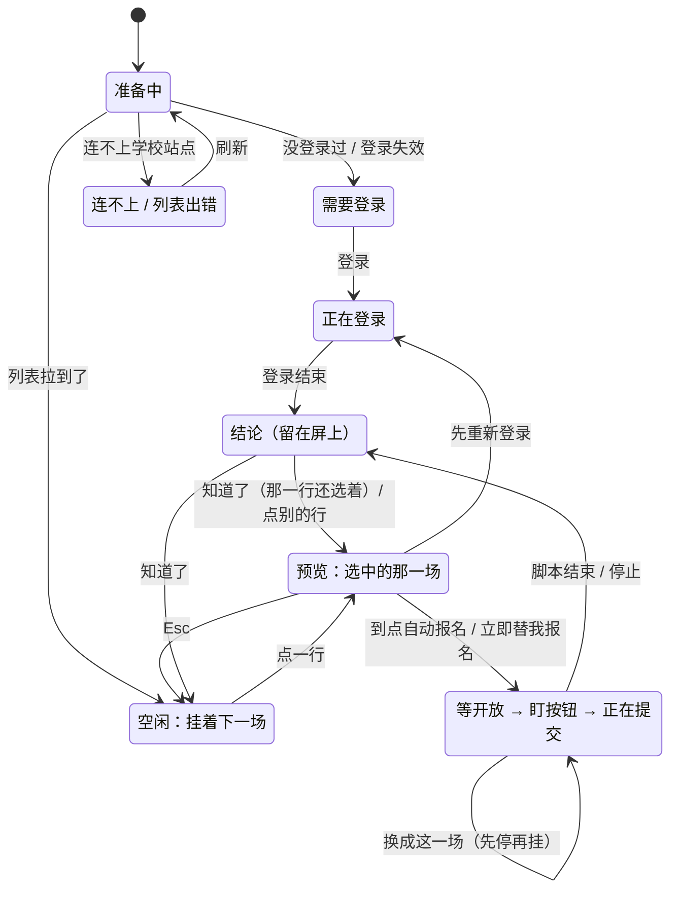

# 准点：天软活动报名 · 本机版界面设计

> 状态：视觉基线已落地，原型继续作为交互参考 · 2026-10-22 · 基线 `main@a66016a`
>
> 交付：本文 + `design/prototype/` 高保真原型（能点、能快进时间、能指定抢报名的结果）+ `design/shots/` 27 张状态截图
>
> 边界：本目录保存 Claude 生成的视觉原型与状态截图；运行时实现位于 `local/ui/`，当前多活动计划和签到/签退筛选以代码与 `docs/UI_SPEC.md` 为准。
>
> 怎么看：双击 `design/prototype/index.html` 看总览，点「打开交互原型」进可操作的窗口；规范在 `components.html`

本文所有关于现有代码的说法都写成 `路径:行号`「原文片段」，`python design/check_refs.py` 会逐条对照基线提交核对。

---

## 目录

1. [结论](#1-结论)
2. [业务规则：设计的边界](#2-业务规则设计的边界)
3. [从代码里读出来的问题](#3-从代码里读出来的问题)
4. [设计概念：候车厅里的一块大屏](#4-设计概念候车厅里的一块大屏)
5. [布局](#5-布局)
6. [大屏状态机](#6-大屏状态机)
7. [挂之前的检查](#7-挂之前的检查)
8. [结果与失败归因](#8-结果与失败归因)
9. [时刻表](#9-时刻表)
10. [交互细节](#10-交互细节)
11. [文案](#11-文案)
12. [视觉规范](#12-视觉规范)
13. [无障碍与窗口适配](#13-无障碍与窗口适配)
14. [接口契约对照](#14-接口契约对照)
15. [原型说明](#15-原型说明)
16. [落地方式](#16-落地方式)
17. [验收清单](#17-验收清单)
18. [已知限制与待老大拍板](#18-已知限制与待老大拍板)

---

## 1. 结论

**整个窗口做成一个候车厅：下面是按报名开放时间排的「时刻表」，上面挂一块 LED「大屏」。大屏一次只亮一场。**

这不是装饰。这个工具的本质是「几点几分开放，我要准时赶上」，跟赶火车一样；而脚本同一时间只能跑一个任务（登录也算），所以界面上只该有一个任务位。大屏就是这个任务位：

- 没选东西时，屏上挂着**全局下一场**和它的倒计时；
- 在时刻表里点一场，它**上屏预览**，屏底下先做检查：登录撑不撑得到开放、本机时钟准不准；
- 点「到点自动报名」，点阵**点亮**（全界面唯一的刻意动效），屏上走倒计时和一条「线路图」，每一站都是脚本里真实的时刻；
- 结束后**结论留在屏上**（绿 ✓ / 红 ✕ + 原因 + 下一步），点「知道了」才收。最小化、锁屏回来也看得到。

和现在的界面比，改了这几件事：

| 现在 | 新设计 | 为什么 |
|---|---|---|
| 6 列表格 + 下方操作区 + 6 行日志 | 时刻表按开放日分组 + 顶部大屏 + 一行运行记录 | 用户真正的问题是「接下来哪场开放、还有多久」，时间才是主角 |
| 已开放超过 2 分钟的场次，点了一次都不试就报「没抢到」 | 已开放的场次按钮叫「立即替我报名」，从现在起试 2 分钟 | §3 问题 1 |
| 登录态会在等待途中过期，失败时说「名额已满」 | 挂之前检查登录撑不撑得到开放；失败后顺手复查，改口说真原因 | §3 问题 2 |
| 主动停止后显示「没抢到：退出码 1」 | 显示「已停止等待」，给「重新开始等」 | §3 问题 3 |
| 已经报过的场次再挂，显示「没抢到：退出码 0」 | 显示「你已经报过这一场」 | §3 问题 4 |
| 时钟偏差只在日志里出现一行 | 顶栏时钟标黄 + 检查条提醒 + 告诉去哪同步 | §3 问题 5 |
| 结果弹窗 + 一行红绿字 | 结论留在大屏，配色、图标、文字三重表达 | 最小化回来状态仍准确 |

刻意**没做**的：多选「报名计划」、同刻并发提交（`docs/UI_DESIGN.md` 草案的方向）。它和工具自己写明的边界冲突，见 §4.3。

## 2. 业务规则：设计的边界

这些规则全部来自代码，界面不能违反，也不该假装能做到。

| # | 规则 | 出处 | 界面怎么接 |
|---|---|---|---|
| R1 | 只对一个活动动作，不批量 | `local/grab.py:13`「只对传入的单个 activity-id 动作，不批量扫活动」 | 大屏一次只等一场；不做多选 |
| R2 | 同一时间只跑一个子进程，登录和抢报名共用 | `local/app.py:243`「if self._proc and self._proc.poll() is None:」`local/app.py:244`「已经有一个任务在跑，先等它结束」 | 大屏 = 任务位；等开放时「重新登录」不可点并说明原因；换场 = 先停再挂 |
| R3 | 一启动就打开活动页，`--lead` 只推迟一行日志 | `local/grab.py:612`「page.goto(url, wait_until="domcontentloaded", timeout=60000)」在 `local/grab.py:630`「wait_until(start)」之前；`local/grab.py:599`「start = now if args.dry_run else at_ts - args.lead」 | 线路图第二站就是「活动页已打开」 |
| R4 | 开放前 5 秒开始找「立即报名」 | `local/grab.py:57`「POLL_LEAD = 5.0」 | 线路图「盯按钮」站；最后 10 秒点阵转红 |
| R5 | 按钮没出现时退避刷新，2 秒起、最多 8 秒 | `local/grab.py:645`「reload_gap = 2.0」`local/grab.py:653`「reload_gap = min(8.0, reload_gap * 1.5)」 | 「正在提交」时说明「每 2 到 8 秒刷新一次」 |
| R6 | 点按钮后最多等学校 12 秒回应 | `local/grab.py:663`「timeout=12000) as info:」 | 「学校没回应」这一类失败 |
| R7 | 只试到开放时刻 + 120 秒 | `local/grab.py:634`「deadline = at_ts + args.window」`local/grab.py:772`「default=120」 | 线路图终点「最晚到这里」；提交时倒数「还能试到」 |
| R8 | 最后用「是否已报名」复核 | `local/grab.py:690`「ok = resp_ok or is_joined(target["id"])」 | 成功文案「去活动页确认一眼」 |
| R9 | 登录态只在启动时查一次 | `local/grab.py:581`「ok, msg = check_token()」（`cmd_grab` 开头，之后不再查） | 挂之前检查登录有效期（§7） |
| R10 | 登录态寿命是估算：保存时刻 + 17.5 小时 | `local/app.py:32`「TOKEN_LIFETIME_H = 17.5」 | 一律写「约剩」「约到 xx 过期」 |
| R11 | 本机时钟和学校差 3 秒以上才警告 | `local/grab.py:588`「if skew is not None and abs(skew) > 3:」 | 同一门槛 |
| R12 | 开放在 24 小时以后要提醒 | `local/grab.py:597`「if at_ts - now > 86400:」 | 检查条「开放在 24 小时以后」 |
| R13 | 列表只留截止不到 1 小时的 | `local/grab.py:214`「return parse_ts(act["sign_end"]) >= now - 3600」 | 「刚截止」分组 |
| R14 | 抢报名成功 = 退出码 0 且输出里有「报名成功」；登录成功只看退出码 | `local/app.py:270`「any("报名成功" in t for t in tail)」`local/app.py:268`「ok = proc.returncode == 0」 | 登录和报名的结果分开处理，登录永远不会显示「没抢到」 |
| R15 | 失败原因 = 最后 40 行里最后一条 `[X] ` 开头的行，没有就是「退出码 N」 | `local/app.py:263`「del tail[:-40]」`local/app.py:274`「if t.startswith("[X] "):」`local/app.py:277`「reason = reason or ("退出码 %s" % proc.returncode)」 | 不直接展示 reason，先归因（§8） |
| R16 | `check` 只回最后一行 | `local/app.py:160`「"text": (res["out"].strip().splitlines() or [""])[-1],」 | 时钟偏差那行恰好是最后一行，能读到；登录失败的原因读不到，改由活动列表的报错来判断 |
| R17 | 等登录最多 600 秒 | `local/grab.py:753`「default=600」 | 正在登录时点阵倒数「最多再等」 |
| R18 | 偏好是浅合并写入 `data/ui.json` | `local/app.py:214`「merged.update(prefs or {})」 | 新增 `headed`、`sound` 两个键，旧键不冲突 |

## 3. 从代码里读出来的问题

设计之前先把现有流程跑了一遍代码。前 4 条会让现在的界面（基线 `main@a66016a` 的 `local/ui/`）给出错误的结论，第 5 条是关键信息藏在日志里，第 6 条是文档和代码对不上。新设计逐条接住了。

### 问题 1：已经开放超过 2 分钟的场次，点了一次都不试就报「没抢到」

- 现在的界面把列表里的开放时间原样传给脚本：`local/ui/app.js:208`「at: it.sign_start || ""」→ `local/ui/app.js:262`「const res = await api("grab", S.selected.id, S.selected.name,」。
- 脚本的截止时刻是 `local/grab.py:634`「deadline = at_ts + args.window」，循环条件是 `local/grab.py:646`「while time.time() < deadline:」。开放已经超过 120 秒，循环一次都不进，直接走到失败分支，打印 `local/grab.py:702`「名额已满／页面未放开」。
- 用户看到的是「没抢到：名额已满／页面未放开」，其实脚本根本没点。
- 命令行（`2-抢活动.bat`、`--pick`）选已开放的场次也一样：`local/grab.py:573`「"at": act["sign_start"]」。

**新设计**：已开放的场次主按钮叫「立即替我报名」，`at` 传「现在」（精确到秒），2 分钟重试窗口从现在起算。大屏文案写明「已经开放 23 分钟了。现在就替你点…」。

### 问题 2：登录态在等待途中过期，失败时被说成「名额已满」

- 脚本只在启动时查一次登录（R9），然后可能等好几个小时；登录态大约 17.5 小时过期（R10）。
- 到点时页面多半已经掉了登录，脚本只会看到「立即报名」按钮没出现（它靠按钮文字找按钮：`local/grab.py:647`「filter(has_text="立即报名")」），最后同样报「名额已满／页面未放开」。

**新设计**：两道保险。挂之前算「登录到期时刻 < 开放 + 2 分钟」就提醒，主按钮换成「先重新登录」（§7）；万一还是失败了，界面顺手复查一次登录态，查出失效就把结论改成「没抢到：登录态失效了」，按钮换成「重新登录」（§8.3）。

### 问题 3：主动停止后显示「没抢到：退出码 1」

- 停止调用 `local/app.py:201`「proc.terminate()」，Windows 上退出码是 1；等待中的输出里没有 `[X] ` 行，reason 就成了「退出码 1」（R15）。
- 现在的界面不区分是谁让它停的：`local/ui/app.js:91`「: "没抢到：" + reason, ok);」。

**新设计**：界面自己记住「是我请求停的」，结束时显示中性的「已停止等待：到点不会再替你报名…」，给「重新开始等」。

### 问题 4：已经报过的场次再挂，显示「没抢到：退出码 0」

- 脚本发现已报名时打印 `local/grab.py:625`「print("[i] 你已经报过这个活动了。")」然后 `local/grab.py:626`「return 0」。
- 输出里没有「报名成功」，所以 `ok` 是假（R14）；也没有 `[X] ` 行，reason 是「退出码 0」。

**新设计**：从实时日志里认出这句话，结论显示「你已经报过这一场」（绿）。

### 问题 5：时钟偏差只在日志里

- 本机慢 6 秒，就会晚 6 秒才点。脚本会打印 `local/grab.py:354`「本机时钟与服务器相差」，但现在的界面只把它当一行日志。

**新设计**：顶栏时钟旁边标「本机慢 6 秒」，检查条里也有，点开告诉你去「设置 › 时间和语言」点「立即同步」。

### 问题 6（文档）：「提前 100 秒打开页面」和代码不符

`local/README.md:106`「报名开放前约 100 秒」打开活动页，但代码是一启动就打开（R3）。功能上没问题（盯按钮时会先刷新一次），只是线路图如果照 README 画就是错的。新设计照代码画；README 的措辞建议另行修正，不在本次范围。

## 4. 设计概念：候车厅里的一块大屏

### 4.1 为什么是车站

用户的处境和赶车一模一样：有一个精确到秒的时刻（学校常定在 `00:59:59` 这种点），错过就没了；等的时候人可以走开，但要有人替你盯着；到点那一下要干脆，结果要一眼看清。

所以借车站的三样东西：

| 车站 | 界面 | 承担的信息 |
|---|---|---|
| 时刻表 | 按开放时间排、按天分组的活动列表 | 哪些能报、几点开放、还有多久 |
| 发车大屏 | 顶部的 LED 屏 | 你正在等的那一场、倒计时、进度、结论 |
| 「现在」 | 时刻表里的「现在」线、顶栏时钟 | 已开放的在线上，没开放的在线下；本机时间准不准 |

### 4.2 只把大胆用在一处

整个界面是安静的浅灰、白色、细线，只有大屏是黑底琥珀字的点阵。琥珀只出现在屏上，意思是「正在等的那一场」；红只在最后 10 秒、提交中、失败时出现；绿只给成功。点阵灭着的点也画出来（暗色），数字跳动时不跳版，看上去像一块真屏。

### 4.3 考虑过、没采用的方案

| 方案 | 没采用的原因 |
|---|---|
| 保留「表格 + 下方操作区」，只换皮 | 状态、选中项、结果分散在三处；结果靠弹窗，最小化回来就丢 |
| 左列表 + 右侧详情栏 | 980 宽时两栏都挤；任务状态被放到次要位置 |
| 多选「报名计划」+ 同刻并发提交（`docs/UI_DESIGN.md` 草案） | 违反 R1、R2。那份草案自己也写了 `docs/UI_DESIGN.md:32`「当前 app.py 的 grab 接口每次只接收一个活动」；要做就得改 `app.py`、`grab.py`，超出「只改界面」的范围，也偏离工具「不批量」的边界 |

## 5. 布局

默认窗口 1120×800（`local/app.py:310`「width=1120, height=800, min_size=(980, 700)」），网页视口约 1120×768：

```
┌────────────────────────────────────────────────────────────────────────────────┐
│ ▣ 准点  天软活动，到点替你报名    21:01:43  (● 登录有效 约剩 14 小时) │ 说明 刷新 [重新登录] │  顶栏 56
│ ┌ 横幅（只在断网、电脑睡过一觉时出现） ──────────────────────────────────────┐ │
│ ╔══ 大屏 212 ════════════════════════════════════════════════════════════════╗ │
│ ║ [未开放] [下一场]                                     ▓▓:▓▓:▓▓  点阵倒计时 ║ │
│ ║ 网络安全·数字时代大长城                                      今天 21:09 开放 ║ │
│ ║ ◎ 教学楼 A301   ▢ 活动 后天 14:00                                          ║ │
│ ║ 点了以后马上在后台打开活动页，开放前 5 秒开始盯「立即报名」…                 ║ │
│ ║ ───────────────────────────────────────────────────────────────────────── ║ │
│ ║ ✓ 登录撑得到开放  ✓ 时钟准      □ 看着它点  □ 结束响一声  [▶ 到点自动报名] ║ │
│ ╚════════════════════════════════════════════════════════════════════════════╝ │
│ ┌ 时刻表（占满剩余高度，自己滚） ─────────────────────────────────────────────┐ │
│ │ 🔍 搜活动名或地点   [可报名 11│已报名 3│全部 15]  [今天│7 天内│不限]  21:01 更新 │ │
│ │ 开放时间   活动                                    地点             距开放 │ │
│ │ 正在开放 现在就能报                                                   1 场 │ │
│ │ 20:38     专升本学习经验交流会                       求是楼 201        开放中 │ │
│ │ ● 现在 21:01 ────────────────────────────────────────────────────────── │ │
│ │ 今天 10月22日 周四                                                     1 场 │ │
│ │ 21:09     网络安全·数字时代大长城                    教学楼 A301    7 分 16 秒 │ │
│ │ 明天 10月23日 周五                                                     4 场 │ │
│ └──────────────────────────────────────────────────────────────────────────┘ │
│ ┌ 运行记录  21:01:51 [i] 后台等待中，到点自动提交…                     展开 ┐ │  收起 38
└────────────────────────────────────────────────────────────────────────────────┘
```

| 区块 | 高度 | 说明 |
|---|---|---|
| 顶栏 | 56（窗口高不足 720 时 50） | 品牌、本机时钟、登录胶囊、说明、刷新、登录 |
| 横幅 | 0 或 36 起 | 只有断网、睡眠两种，平时不占地方 |
| 大屏 | 212（190） | 左：标签、标题、地点和活动时间、一句说明；右：点阵 + 一行标注；底栏：检查条 / 线路图 / 按钮 |
| 时刻表 | 剩余高度 | 筛选栏 + 吸顶表头 + 吸顶分组条；只有它滚动 |
| 运行记录 | 38（展开 +196） | 收起时只显示最新一句 |

**不用滚动就能同时看到「状态 + 列表 + 主按钮」**：大屏固定在上，主按钮固定在大屏右下角，时刻表在 980×700 下也能同时看到 3 场左右（加上分组条）。

## 6. 大屏状态机

大屏同一时刻只显示一种状态，按下面的优先级取第一个成立的：



| 优先级 | 状态 | 什么时候 | 点阵 | 主按钮 | 截图 |
|---|---|---|---|---|---|
| 1 | 正在登录 | 登录子进程在跑 | 琥珀，倒数「最多再等」10 分钟 | 取消登录 | 03 |
| 2 | 等开放（5 个阶段，见下） | 抢报名子进程在跑 | 琥珀 / 红 | 停止 | 07–09 |
| 3 | 有任务在跑 | 界面打开时后端说已经有任务（`bootstrap().busy`） | 本机时间 | 停止 | — |
| 4 | 结论 | 任务刚结束，用户还没点「知道了」 | 绿 ✓ / 红 ✕ / 灭灯 | 视结论而定（§8） | 10–12、19–22 |
| 5 | 预览 | 选中了一行 | 未开放：暗琥珀倒计时；开放中：距截止；已报名：绿 ✓ | 到点自动报名 / 立即替我报名 / 先重新登录 | 04–06、16 |
| 6 | 准备中 | 第一次拉列表还没回来 | 本机时间 | — | — |
| 7 | 需要登录 | 没登录过 / 登录失效 | 本机时间 | 登录 / 重新登录 | 02、17 |
| 8 | 连不上 | 列表报网络类错误 | 本机时间 | 刷新 | 15 |
| 9 | 空闲 | 其余情况 | 暗琥珀，下一场的倒计时 | 选这一场 | 01 |

**等开放的 5 个阶段**（全部由脚本的真实时刻和日志推出来，不编进度百分比）：

| 阶段 | 判断依据 | 标签 | 点阵 | 说明文字 |
|---|---|---|---|---|
| 准备中 | 还没收到日志「详情页已加载」 | 准备中 | 琥珀，距开放 | 正在后台打开活动页… |
| 等开放 | 已加载，距开放 > 5 秒 | 等开放（呼吸点） | 琥珀，最后 10 秒转红 | 电脑别睡眠、别断网… |
| 马上开放 | 距开放 ≤ 5 秒 | 马上开放（红） | 红 | 正在盯「立即报名」，按钮一出现就点 |
| 正在提交 | 开放后、120 秒内 | 正在提交（红） | 琥珀，倒数「还能试到」 | 第 2 次提交：学校回「未到报名时间」。接着试 |
| 收尾中 | 超过 120 秒还没结束 | 收尾中 | 灭灯 | 超过 1 分钟仍未结束就提示可以停止、看运行记录 |

**线路图**画在等开放时的大屏底栏，5 站：开始等待 → 活动页已打开 → 盯按钮（开放前 5 秒）→ 开放 → 最晚到这里（开放 + 120 秒）。走过的站变白，当前站琥珀，进入盯按钮和开放后变红。已开放的场次只有 3 站。

## 7. 挂之前的检查

选中一场后，大屏底栏先给出检查结果，再给按钮。挡住的情况不给「到点自动报名」：

| 情况 | 屏上说 | 按钮 |
|---|---|---|
| 已报名 | 你已经报过这一场，不用再抢。 | 无 |
| 报名已截止 | 报名已经截止了。 | 无 |
| 报名时间待公布 | 报名时间还没公布。公布以后点「刷新」再来。 | 刷新 |
| 没登录过 / 登录失效 | 还没登录…… / 登录态失效了，先重新登录。 | 登录 / 重新登录 |
| 连不上学校站点 | 连不上学校站点，现在点了也会失败…… | 刷新 |

不挡、但要提醒的（检查条上一个个小标签，绿 ✓ / 橙 ⚠ / 红 ✕）：

| 检查 | 规则 | 不通过时 |
|---|---|---|
| 登录撑得到开放 | 预计到期 ≥ 开放 + 120 秒 | ⚠「登录约 22:58:53 过期」。现在重新登录就能撑到开放的话，主按钮换成**「先重新登录」**，旁边留文字链「照样到点报名」；开放比 17 小时还远、现在登录也撑不到的话，说明「开放前 17 小时内重新登录，再来点」 |
| 时钟准 | 和学校相差 ≤ 3 秒（R11） | ⚠「本机慢 6 秒」，说明会晚几秒点、去哪同步 |
| 网络 | `navigator.onLine` | ✕「网络断开了」 |
| 开放在 24 小时以后 | R12 | ⚠ 提醒，不挡 |

两个开关也在这里：**看着它点**（对应 `grab(…, headed)`，显示浏览器窗口）、**结束响一声**（界面用 WebAudio 合成两三个音，不带音频文件）。两者都记进 `data/ui.json`。

## 8. 结果与失败归因

### 8.1 结论一览

| 结论 | 点阵 | 标题 | 下一步 |
|---|---|---|---|
| 报名成功 | 绿 ✓ | 报名成功：网络安全·数字时代大长城 | 去活动页确认一眼。不想去就尽快在活动页取消，别占名额。［知道了］ |
| 已经报过 | 绿 ✓ | 你已经报过这一场 | ［知道了］ |
| 没抢到 | 红 ✕ | 没抢到：〈归因后的原因〉 | 见 8.2 |
| 已停止 | 灭灯 | 已停止等待 | ［重新开始等］［知道了］ |
| 登录好了 | 绿 ✓ | 登录好了 | 大约 17 小时内有效，约到 明天 14:36。活动列表正在刷新。［知道了］，6 秒后自动收起 |
| 登录没完成 | 红 ✕ | 登录窗口被关掉了 / 等了 10 分钟还没登录成功 / 打不开学校的登录页 / 登录后学校那边没校验通过 / 没找到能用的浏览器 | ［再试一次］ |

登录的结论和报名的结论走两条路（R14），所以登录结束永远不会出现「没抢到」。

### 8.2 没抢到：怎么归因

不直接展示 reason（R15），而是把 reason、实时日志里每一次提交的结果一起看：

| 信号（按顺序匹配） | 归为 | 标题 | 按钮 |
|---|---|---|---|
| 输出含「还没有登录过 / 登录态已过期 / 身份验证失败」 | 登录 | 没抢到：登录态失效了 | 重新登录 |
| 「没找到可用的浏览器」 | 浏览器 | 没抢到：没找到能用的浏览器 | 知道了 |
| `net::ERR_…` / 「接口异常」/ 本机离线 | 网络 | 没抢到：连不上学校站点 | 刷新 |
| 「找不到报名开始时间」 | 时间 | 没抢到：报名时间还没公布 | 刷新列表 |
| 最后一次提交是「未收到 signUp 响应」（`local/grab.py:672`「last_reason = "未收到 signUp 响应"」） | 无回应 | 没抢到：学校没回应 | 刷新列表；文案提醒「说不定其实报上了，去活动页确认」 |
| 最后一次提交是 `code:N 消息`（`local/grab.py:668`「last_reason = "code:%s %s" % (」），消息含「满 / 名额」 | 满员 | 没抢到：名额已满 | 刷新列表 |
| 同上，消息含「未开始 / 未到 / 尚未」 | 未开放 | 没抢到：学校说还没到报名时间 | 刷新列表（可能推迟了，或本机时钟快了） |
| 同上，其他消息 | 学校拒绝 | 没抢到：〈学校原话〉 | 知道了 |
| 一次都没提交（按钮始终没出现） | 满员或没放开 | 没抢到：名额已满，或页面一直没放开 | 刷新列表 |
| 其他 | 不明 | 没抢到：〈reason〉 | 看运行记录 |

> 学校接口返回的具体文字目前只有成功的样本。「满 / 名额 / 未开始」这些关键词是推测；匹配不上时直接显示学校原话，不会说错，只是不够短。拿到真实样本后调整关键词即可。

### 8.3 失败后顺手复查

任何「没抢到」之后，界面自动刷新一次（`check` + `list_activities`）。如果活动列表报登录失效，结论改口为「没抢到：登录态失效了」，说明「脚本只看到『立即报名』一直没出现。顺手查了一下，登录态已经失效，这多半才是原因」，主按钮换成「重新登录」（截图 12）。复查期间屏底写「正在顺手复查登录态…」。

### 8.4 结论什么时候收起

点「知道了」、按 Esc、或在时刻表里点别的行。登录成功的结论 6 秒后自动收起；其他结论一直留着，直到用户确认，最小化、锁屏回来也看得到。成功和失败同时用 `aria-live` 播报，开了「结束响一声」会响。

## 9. 时刻表

### 9.1 分组与排序

从上到下：

1. **正在开放**（现在就能报），按开放时间
2. **「现在」线**：黑色细线 + 「现在 21:01」，把已开放和未开放隔开
3. **按开放日分组**：今天 / 明天 / 后天 / 10月26日 周日……组内按开放时间
4. **报名时间待公布**
5. **刚截止**（截止不到 1 小时的，R13）
6. **已报名**

分组条和表头吸顶。排序选项删掉了：时间顺序本身就是这张表要传达的信息。

### 9.2 一行的结构

| 列 | 宽 | 内容 |
|---|---|---|
| 开放时间 | 76 | 大号 Bahnschrift `21:09`；学校爱用的秒（`:59`）写成上标；不按天分组的行（正在开放、刚截止、已报名）在下面补一行「昨天 / 10月20日」 |
| 活动 | 弹性 | 活动名（一行，超长省略，悬停看全名）；下面一行：开放中的写「报名截止 明天 00:38」，都写「活动 后天 14:00」 |
| 地点 | 156 | 地点，空的写「地点待定」 |
| 距开放 | 132 | 未开放：`7 分 16 秒` / `2 时 53 分` / `1 天 3 时`；开放中：「开放中」+「已开放 23 分钟」；其余：标签 |

行状态：默认 / 悬停 / 选中（浅蓝底 + 左侧铁路蓝竖条）/ 正在等（左侧黑竖条 + 「等开放」「提交中」标签）/ 下一场（黑底「下一场」标签）/ 已报名、已截止（标题变常规字重、时刻变灰）/ 刚报上（本次抢到、列表还没刷新时，绿底「刚报上」）。

选中的行如果不是大屏正在等的那一场，行内展开一条说明：「大屏正在等『网络安全·数字时代大长城』。一次只能等一场。［换成这一场］」（截图 13）。

### 9.3 筛选

- 状态：**可报名**（默认，去掉已报名和已截止）/ 已报名 / 全部，每项带计数
- 时间：今天 / 7 天内 / 不限（默认）。正在开放的场次不受时间筛选影响，因为它现在就能报
- 搜索：活动名或地点，120ms 防抖
- 都记进 `data/ui.json`，下次打开恢复
- 「下一场」按全部活动算，不受筛选影响；没选东西时它一直挂在大屏上

### 9.4 每秒更新

只改倒计时那几格的文字，不重排、不闪。只有某一行跨过边界（开放了、截止了）或「下一场」换人时才整表重画。计时器对齐到整秒，倒计时跳秒和系统时钟同步。

### 9.5 空状态

| 情况 | 标题 | 说明 | 按钮 |
|---|---|---|---|
| 第一次拉取中 | （6 行骨架） | | |
| 正在登录 | 正在登录 | 在 Chrome 窗口里登录好，这里会自动列出近期的活动。 | |
| 没登录过 | 先登录一次 | 登录以后这里会列出近期的活动。点「登录」会弹出 Chrome，输入学号、密码和验证码。 | 登录 |
| 登录失效 | 登录态失效了 | 重新登录以后，这里会自动刷新。 | 重新登录 |
| 连不上 | 连不上学校站点 | 检查网络、校园网或代理，然后点「刷新」。 | 刷新 |
| 列表为空 | 这里还没有活动 | 点「刷新」拉一次；提示登录态失效就先点「登录」。 | 刷新 |
| 筛选没结果 | 没有符合筛选的活动 | 一共 15 场，换个关键词，或者放宽筛选。 | 清除筛选 |

## 10. 交互细节

| 操作 | 行为 |
|---|---|
| 单击一行 | 选中，上屏预览 |
| 双击一行 | 选中，并把焦点放到大屏主按钮上（再按 Enter 才开始）。不直接开抢：先让人看到检查条，避免没看到「登录撑不到开放」就挂上 |
| Enter | 选中了一场、焦点又不在按钮上时，等于按大屏的主按钮 |
| ↑ / ↓ | 在时刻表里移动选中 |
| Esc | 依次：关浮层 → 退出搜索框 → 收起结论 → 取消选中 |
| F5 | 刷新（检查登录 + 拉列表），不会触发报名 |
| Ctrl+F 或 / | 跳到搜索框 |
| 停止 | 二次确认。等待中：「停止以后，到点不会再替你报名『…』」；提交中：「可能已经交上去一次了，记得去活动页确认」 |
| 换成这一场 | 二次确认后，先停当前这场，收到结束事件后自动挂新的一场，不显示「已停止」结论 |
| 等开放时点「重新登录」 | 按钮不可用，悬停说明「正在等开放：先停止，才能重新登录（同一时间只能跑一个任务）」 |
| 点登录胶囊 | 浮层：预计到期时刻、还剩多久、估算口径、重新登录 |
| 点顶栏时钟 | 浮层：本机比学校快 / 慢几秒、影响、去哪同步 |
| 运行记录 | 收起时一行最新；展开后可复制全部、清空、打开数据目录（`open_data`）；新行到达时，如果已滚到底就跟随 |
| 断网 | 顶部红色横幅；正在等开放时额外说「到点时还没恢复，这次报名会失败」 |
| 电脑睡过一觉 | 等开放期间，界面两次心跳间隔超过 2 分钟，就出黄色横幅：「刚才有 25 分钟界面没动静，电脑可能睡眠了…」 |

## 11. 文案

规则沿用 `docs/UI_SPEC.md` §6：中文、第二人称、短句，不用「请」「您」，不写技术词。补三条：

1. **一个动作从头到尾一个名字**：「到点自动报名」→ 屏上「等开放」→「报名成功：…」；「立即替我报名」→「正在提交」；「停止」→「已停止等待」；「登录」→「正在登录」→「登录好了」。
2. **错误回答两件事**：发生了什么 + 现在能做什么。不道歉、不含糊。
3. **说估算就写「约」**：登录剩余时间、到期时刻都带「约」（R10）。

用词对照：

| 不写 | 写 |
|---|---|
| token、会话 | 登录态 |
| 接口、API | 学校站点 |
| 详情页 | 活动页 |
| 子进程、任务队列 | 脚本 |
| 日志 | 运行记录 |
| 退出码 N | （归因后的原因，见 §8.2） |

`docs/UI_SPEC.md` §6 要求必须保留的 5 个信息点：

| # | 信息点 | 在哪 |
|---|---|---|
| 1 | 空列表：「这里还没有活动」+ 点「刷新」拉一次；提示登录态失效就先点「登录」 | 时刻表空状态（截图 18） |
| 2 | 未登录 / 失效：胶囊显示状态，主按钮仍是「登录 / 重新登录」 | 胶囊「还没登录」「登录已失效」；顶栏按钮转实心（截图 02、17） |
| 3 | 成功：「报名成功：〈活动名〉」+ 建议去活动页确认一眼 | 大屏结论（截图 10） |
| 4 | 失败：「没抢到：〈原因〉」，原因含名额已满 / 页面还没放开 / 登录态失效 / 连不上学校站点 | 大屏结论，§8.2（截图 11、12） |
| 5 | 使用说明：三步（先登录 / 选活动 / 保持在线）+ 只给本人账号用、不要多开 | 首次自动弹出，顶栏「说明」随时再开（截图 02） |

## 12. 视觉规范

完整规范和活组件见 `design/prototype/components.html`。要点：

**色彩**

| 名 | 值 | 用途 |
|---|---|---|
| 厅 | `#E8ECEF` | 窗口底色 |
| 纸 | `#FFFFFF` / `#F4F6F8` | 时刻表、弹窗 / 分组条、输入框 |
| 墨 | `#1A1F24` / `#4E5964` / `#616C76` | 正文 / 副信息 / 表头与计数 |
| 铁路蓝 | `#1E5A8C`，选中底 `#E3EDF6` | 只表示「能点、已选中」：选中竖条、焦点环、链接 |
| 屏 | `#121513`，6px 点阵纹理 | 只给大屏 |
| 琥珀 | `#FFB020` / 暗 `#B98319` | 正在等、屏上主按钮 / 还没开始等的倒计时 |
| 信号红 | `#FF5B48` | 最后 10 秒、提交中、没抢到 |
| 信号绿 | `#45DC8A` | 成功 |
| 浅底状态 | 成功 `#146C43/#E1F3E9`、失败 `#B63227/#FBE6E3`、提醒 `#8F5600/#FFF0D4` | 标签、横幅、胶囊 |

**字体**（只用 Windows 自带的，不引外部字体）

| 字体 | 用在 |
|---|---|
| 微软雅黑 UI | 界面文字。字号 21（大屏标题）/ 20（弹窗标题）/ 18（品牌）/ 16（空状态标题）/ 14（活动名）/ 13（正文）/ 12（辅助），窄窗口下大屏标题降到 19、17 |
| Bahnschrift（Win10 起自带，源自德国铁路标识字 DIN） | 所有时刻、倒计时、计数；等宽数字，跳秒不晃。字号 30（说明里的步骤号）/ 22（开放时刻）/ 16（顶栏时钟）/ 15（距开放） |
| Cascadia Mono / Consolas | 运行记录 |

**点阵屏**：5×7 点，点半径是点距的 0.36，字间空一列；灭灯点 `#232823` 也画出来。SVG 绘制，只在字符变化时改对应点的 class。高度 72px（窗口高不足 720 时 56，宽不足 1060 时 60）。字库只有 0–9、冒号、横杠、空格、✓、✕。

**尺寸**：8px 栅格；圆角 14（大屏）/ 10（卡片）/ 8（按钮）/ 6（小控件）/ 4（标签）/ 999（胶囊）；阴影只给浮层（弹窗、轻提示、浮层卡片）和分段控件的选中项，页面里的区块只用 1px 描边。

**动效**：只有一个刻意安排的——点「到点自动报名」时点阵闪着亮起来（420ms，像车站换牌）。其余都是状态提示：呼吸点（1.4s）、大屏换状态淡入（160ms）、弹窗上移淡入（140–180ms）、刷新转圈。系统开了「减少动态效果」时全部关掉。

## 13. 无障碍与窗口适配

**对比度**（WCAG AA，正文 ≥ 4.5:1，已逐对计算）

| 前景 / 背景 | 对比度 |
|---|---|
| 墨 `#1A1F24` / 白 | 16.6 |
| 墨 2 `#4E5964` / 白 | 7.2 |
| 墨 3 `#616C76` / 白、`#F4F6F8`、选中底 `#E3EDF6` | 5.4、5.0、4.5 |
| 屏上字 `#ECEFEA` / `#A7AFA9` / `#7E8781` 在屏 `#121513` 上 | 15.9 / 8.2 / 5.0 |
| 琥珀 / 暗琥珀 / 红 / 绿 在屏上 | 10.1 / 5.5 / 6.0 / 10.4 |
| 屏上主按钮字 `#1D1505` / 琥珀 | 9.9 |
| 成功 / 失败 / 提醒 文字在各自浅底上 | 5.6 / 5.1 / 5.3 |

**语义与键盘**：时刻表是 `listbox`，行是 `option`，用 `aria-activedescendant` 跟随选中；大屏 `aria-live="polite"`，结果另用 `assertive` 播报；顶栏按钮在窄窗口下只剩图标时，文字改为仅读屏可见，名字不丢；状态从不只靠颜色（标签都有文字，结论有 ✓/✕ 图形）；`:focus-visible` 2px 铁路蓝描边（屏上换成琥珀）。

**窗口**：

| 情况 | 视口 | 处理 | 截图 |
|---|---|---|---|
| 默认 | 1120×768 | 标准布局 | 01 等 |
| 最小 | 980×668 | 页边距 12、副标题收起、开关文字缩短、大屏 190 高 | 25、26 |
| 150% 缩放 | 取决于窗口尺寸有没有按 DPI 换算 | 换算了：同默认；没换算（视口约 746×512）：大屏变矮、点阵缩到 38px 但仍在标题右侧，地点列收起，时刻表仍留几行 | 27 |

`local/app.py:298`「SetProcessDpiAwareness(1)」之后 pywebview 是否按 DPI 放大窗口尺寸，没在真机验证（§18）。原型在 1120×768 @1.5x、980×668、746×512 三种视口下实测 `scrollWidth == clientWidth`，没有横向滚动条。

## 14. 接口契约对照

界面只用 `local/app.py` 现有的方法和事件，参数和返回结构不变。

| 调用 / 事件 | 界面怎么用 |
|---|---|
| `bootstrap()` | 启动时唯一 `await` 的调用：版本、偏好、`login.hours_left`（`local/app.py:118`「"login": {"hours_left": token_hours_left()},」）、`busy`（为真时大屏进入「有任务在跑」） |
| `check()` → `onBackend.check` | 读 `ok`、`hours_left`；从 `text` 里认时钟偏差（R16） |
| `list_activities()` → `onBackend.activities` | 成功：用 `id / name / place / sign_start / sign_end / act_start / signed`，状态按时间现算；失败：按 `text` 分成「没登录过 / 登录失效 / 连不上 / 其他」 |
| `login()` → `onBackend.done(kind:"login")` | 结束后自己调一次 `list_activities()` |
| `grab(id, name, at, headed)` → `onBackend.done(kind:"grab")` | 未开放：`at` = `sign_start`；已开放：`at` = 现在（问题 1） |
| `onBackend.log` | 原样进运行记录；同时认几句关键日志推进大屏（详情页已加载、第 N 次提交、你已经报过、时钟偏差） |
| `stop()` | 停止 / 取消登录 / 换场；界面自己记「是我停的」（问题 3） |
| `open_data()` | 运行记录里的「打开数据目录」 |
| `save_prefs(patch)` | 见下 |
| `front_ready()` | 启动完成后调一次 |
| `help()` | **不用**。它返回的文案是旧按钮名（`local/app.py:124`「"title": "报名值守台",」），说明文案写在页面里 |

`data/ui.json` 的键：

| 键 | 说明 |
|---|---|
| `welcome_seen` | 不变 |
| `filter` | `{q, status, time}`；去掉了 `docs/UI_SPEC.md:134`「sort:"open"」里的排序（时刻表固定按时间） |
| `log_open` | 不变 |
| `headed` | 新增：「看着它点」 |
| `sound` | 新增：「结束响一声」 |

## 15. 原型说明

### 15.1 文件

```
design/
├─ README.md               本文
├─ check_refs.py           核对本文引用的代码行（基线 a66016a）
├─ shots/                  27 张状态截图；board/ 下是只截大屏的版本
└─ prototype/
   ├─ index.html           总览：截图墙，点一张就在原型里打开同一个场景
   ├─ play.html            交互原型：1120×800 窗口 + 原型控制台 + 模拟的 Chrome 登录窗
   ├─ components.html      组件与规范（用界面自己的 CSS 渲染）
   ├─ app.html             界面本体  → 落地为 local/ui/index.html
   ├─ app/app.css          样式      → local/ui/styles.css
   ├─ app/app.js           逻辑      → local/ui/app.js
   ├─ app/led.js           点阵屏    → local/ui/led.js（新文件）
   └─ proto/               只给原型用，不进 local/ui
      ├─ mock-backend.js   冒充 app.py + grab.py
      ├─ play.css/js       交互原型外壳
      ├─ sheet.css         总览、规范页的版式
      └─ shoot.py          批量截图
```

双击就能打开（file://），不请求任何外部资源。

### 15.2 假后端照抄了什么

`proto/mock-backend.js` 按真实代码写，换真后端时界面一行不用改：

- 方法名、参数、立即返回值、事件名和载荷字段；
- 同一时间只允许一个子进程，登录和报名共用（R2）；
- 日志原话、退出码，以及 `done` 的 `ok` / `reason` 算法（R14、R15）；
- 抢报名时序：一启动就开页、开放前 5 秒开始找按钮、2→8 秒退避刷新、开放后最多 120 秒、每次提交的 `code:N 消息` 格式；
- `check` 失败时只回最后一行（R16）。

模拟的部分：时间可以暂停和快进；Chrome 登录窗是页面里画的；学校返回的失败消息是编的（§8.2 的提示）。

### 15.3 控制台能做什么

- **场景**：24 个，分 6 组——日常（打开就是这样、全部视图）、第一次（第一次打开、正在登录、登录好了、登录没完成）、挑一场（选中一场、登录撑不到开放、已经开放的场次、筛选没结果、本机时钟慢 6 秒）、等开放（等开放、开放前 5 秒、正在提交、想换一场、电脑睡过一觉）、结果（报名成功、名额已满、登录中途失效、已经报过、已停止）、出状况（登录态失效、断网、列表是空的）
- **时间**：暂停 / 继续、+1 分钟、+10 分钟、+1 小时、跳到开放前 15 秒、跳到开放后 1 分 50 秒
- **下一次报名的结果**：一次成功、第 3 次才成功、名额已满、学校一直回「报名尚未开始」、学校不回应、等的时候登录失效、开放那一刻断网、其实已经报过、电脑上没有浏览器
- **下一次登录的结果**：在弹出的窗口里操作 / 自动成功 / 关掉窗口 / 超时 / 打不开登录页 / 登录后校验失败
- **环境**：网络、本机时钟（准 / 慢 6 秒 / 快 5 秒）、登录态（有效 / 快过期 / 失效 / 没登录）、飞书通知、模拟电脑睡了 25 分钟
- **窗口**：1120×800 / 980×700

### 15.4 重新截图

```bash
python design/prototype/proto/shoot.py            # 全部 27 张 → design/shots/
python design/prototype/proto/shoot.py armed      # 只截一个场景
```

用本机 Edge（没有就用 Chrome）打开 `app.html?scene=…&freeze=1`，场景跑完后原型时钟停住再截。有页面报错时脚本退出码为 1。

## 16. 落地方式

以下是原型阶段的落地建议，保留用于追溯；当前实现已经按多活动计划和签到/签退字段扩展了 `app.py`、`grab.py` 与 `local/ui/`：

1. `app.html` → `local/ui/index.html`，**删掉** `proto/mock-backend.js` 那一行 `<script>`，三处路径改成 `styles.css`、`led.js`、`app.js`；
2. `app/app.css` → `local/ui/styles.css`，`app/app.js` → `local/ui/app.js`，`app/led.js` → `local/ui/led.js`；
3. 按 `docs/UI_SPEC.md` §10 自检：`python -m py_compile app.py`、`node --check ui/app.js`、`python app.py --demo` 截图；
4. 当前运行时以 `local/ui/` 和 `docs/UI_SPEC.md` 为准，原型脚本只用于复现设计状态，不作为业务数据源。

下面几条后端改动能让界面更准，**都不是必须的**，列在这里供以后参考：

| 建议 | 好处 |
|---|---|
| `done` 载荷加 `stopped: true` | 界面不用自己记「是我停的」 |
| `check` 回完整输出，不只最后一行 | 登录失败的原因和时钟偏差能同时拿到 |
| `grab.py` 在开放前几分钟再查一次登录态，失效就提前退出 | 问题 2 从「失败后改口」变成「开放前就喊人」 |
| `list --json` 带上 `act_end`（`local/grab.py:187`「"act_end": raw.get("hdjssj") or "",」已经抓了，`local/grab.py:410`「"act_start": act["act_start"],」附近输出时没带） | 可以显示活动时长 |
| 窗口标题、`help()` 文案换成新名字（`local/app.py:309`「"天软校园活动 · 报名值守台", str(UI),」） | 标题栏和界面一致 |
| `local/README.md` 第 106 行「报名开放前约 100 秒打开」改成「一启动就打开」 | 文档和代码一致（问题 6） |
| `resolve_target` 对已开放的场次把 `at` 取「现在」 | 命令行选已开放的场次也能真的去试（问题 1） |

## 17. 验收清单

`docs/UI_SPEC.md` §3 的真实场景：

| 场景 | 处理 | 截图 |
|---|---|---|
| 第一次打开、没登录过 | 先弹说明；大屏和列表都只引导登录 | 02 |
| 登录态还剩 3 小时 / 不到 2 小时 | 胶囊「约剩 3 小时」；不到 2 小时转橙「登录快过期」 | 05 |
| 列表几百条、能报的只有几条 | 默认「可报名」+ 时间筛选 + 搜索；按天分组 | 01、14 |
| 活动还没开放 | 时刻表和大屏每秒走字 | 01、04 |
| 开放那一刻 | 点阵转红、线路图走到「盯按钮」「开放」、提交次数实时显示 | 08、09 |
| 抢成功 | 绿 ✓ + 去活动页确认一眼 | 10 |
| 没抢到 | 红 ✕ + 归因后的原因 + 下一步 | 11、12 |
| 锁屏 / 最小化回来 | 结论留在大屏；睡过一觉有横幅 | 24 |
| 断网 | 说清是网络问题，给刷新 | 15 |

`docs/UI_SPEC.md` §9 验收项在原型里的情况：

- [x] 未登录 / 拉取失败 / 列表为空 三种状态都有明确引导（02、15、18）
- [x] 选行 → 「到点自动报名」可用；不选时不出现；忙碌时只有「停止」，能停止（04、07、19）
- [x] 「距开放」每秒更新，不重排整表、不闪烁（§9.4）
- [x] 抢报名成功 / 失败 颜色 + 文案正确，一眼可见（10、11、12）
- [x] 登录成功后自动刷新列表，不误报「没抢到」（21）
- [x] 使用说明可反复打开（顶栏「说明」）
- [x] 运行记录展开 / 收起正常，长日志不撑破布局
- [x] 980×700 与 1120×800、150% 缩放下无横向滚动条（实测，见 §13）
- [x] 没有外部请求（原型只加载本地文件）
- [ ] `python app.py --demo` 下所有状态都能看到——落地后才能验；原型里用 24 个场景代替

## 18. 已知限制与待老大拍板

**待拍板**

1. **名字**：提议叫「准点」，副标题「天软活动，到点替你报名」。不想换名就用「天软活动报名」，界面结构不受影响。窗口标题栏的字来自 `app.py`，按约束这次没改。
2. **双击行为**：现在的界面双击直接开抢；新设计改成「选中 + 聚焦主按钮」，多按一次 Enter。理由见 §10。
3. **「结束响一声」默认关**：要不要默认开。

**已知限制**

1. 登录剩余时间是估算（R10，单次实测样本），「登录撑得到开放」可能偏乐观或偏悲观，所以只提醒、不硬挡。
2. 学校返回的失败消息没有真实样本，§8.2 的关键词是推测；匹配不上时显示原话。
3. 睡眠检测靠界面心跳，门槛 2 分钟。Chromium 对隐藏页面的计时器最多压到每分钟一次，门槛高于它，不会误报；但如果窗口被系统挂起且心跳恢复前用户没回来，横幅会晚出现。
4. 150% 缩放下 pywebview 是否按 DPI 换算窗口尺寸没在真机验证；两种情况原型都兜住了。
5. 「看着它点」只对下一次挂上生效（`headed` 在启动脚本时传入），所以等开放时不显示这个开关。

---

### 附：引用校验

```bash
python design/check_refs.py
```

逐条核对本文里的 `路径:行号`「片段」是否原样出现在基线 `a66016a` 的那一行；`docs/UI_DESIGN.md` 还没提交，按工作区核对。
