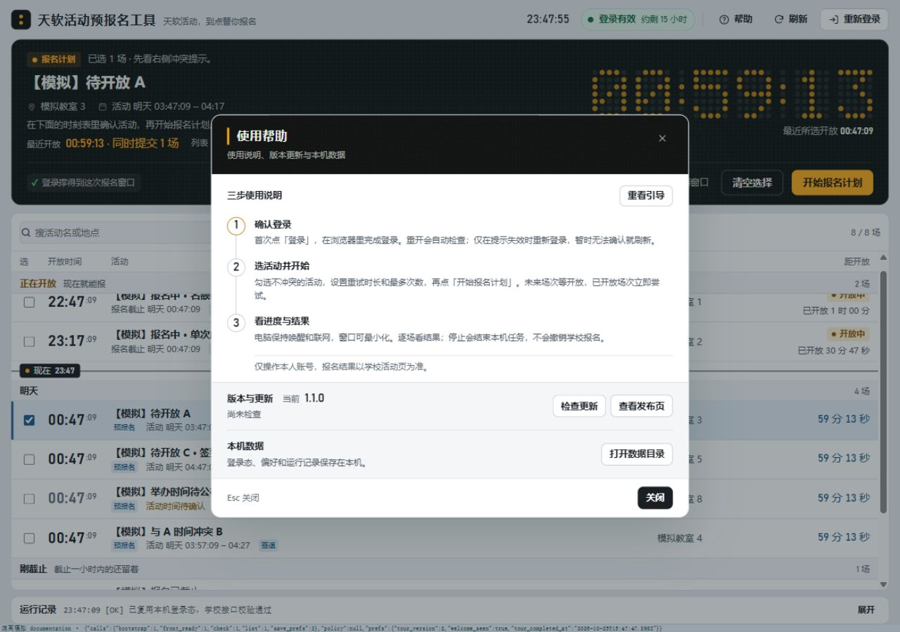

# 当前界面截图（2026-10-25）

> 本目录是生产 UI 的隔离模拟渲染；[design/shots](../shots/) 保留最初视觉原型。
> 本轮替换旧草案期截图，当前软件为 **1.1.0 未发布候选**。

## 截图索引

| 文件 | 内容 |
|---|---|
| [help-center.png](help-center.png) | 统一帮助：三步说明、重播、当前版本、手动更新与本机数据；尚未发起检查 |
| [guide-login.png](guide-login.png) | 六步引导第 1 步「登录状态」：高亮登录区 |
| [guide-retry.png](guide-retry.png) | 第 5 步「重试与开始」：高亮策略与计划操作区 |
| [guide-progress.png](guide-progress.png) | 第 6 步「运行与结果」：高亮大屏 |
| [local/gui-preview.png](../../local/gui-preview.png) | 主界面：勾选一场未来活动，开始操作与真实模式标签可见；根和本机 README 共用 |

## 生成方式与来源

- 日期：2026-10-25，本轮 `20261025-help-center-update-check`。
- 来源：分支 `codex/lifecycle-tour-release`，基线 `f5bf526` 加本轮尚未提交的帮助改动；
  候选号来自根 `VERSION=1.1.0`。本轮截图期间的后续时序修复不改变可见布局。
- 生产 `local/ui/` 文件由回环 HTTP 服务原样提供，HTML 额外加载模拟桥并加测试页标题前缀；
  没有在生产 JS 中插入测试钩子。页面底部的「隔离模拟」细条是夹具计数器，不属于产品。
- 数据：8 场均带「【模拟】」标识，包含预报名、立即报名、冲突、签到/签退未知、已截止与已报名；
  不含真实学号、姓名或凭证，不访问学校。CSP 仅放行本地同源资源，测试桥不会调用外部接口。
- 工具：Codex 内置浏览器，1280×900、100% 视口；直接页面截图 API。
  窄窗另验 746×512 与 680×512，证据留在本轮结果引用的临时目录。
- 操作：通过真实复选框选中未来活动；打开「帮助 → 重看引导」后依次点击下一步，
  拍第 1/5/6 步。未调用页面内部业务函数，也不是首次自动引导的证据。
- PNG 原始截图直接复制入库，没有修图。旧 3.1.0 草案期图片已由本轮重拍替换，历史版本可在 Git 查阅。

## 证据边界

这些是源码 UI 的浏览器证据，**不代表真实登录、学校报名或 EXE 原生窗口验收**。
图中登录有效、剩余时间、学校活动均由模拟桥提供。EXE 另做内置源码比对与单文件空目录离线探针，
用户视觉和真实学校流程仍待确认；本轮未发布 Release。
