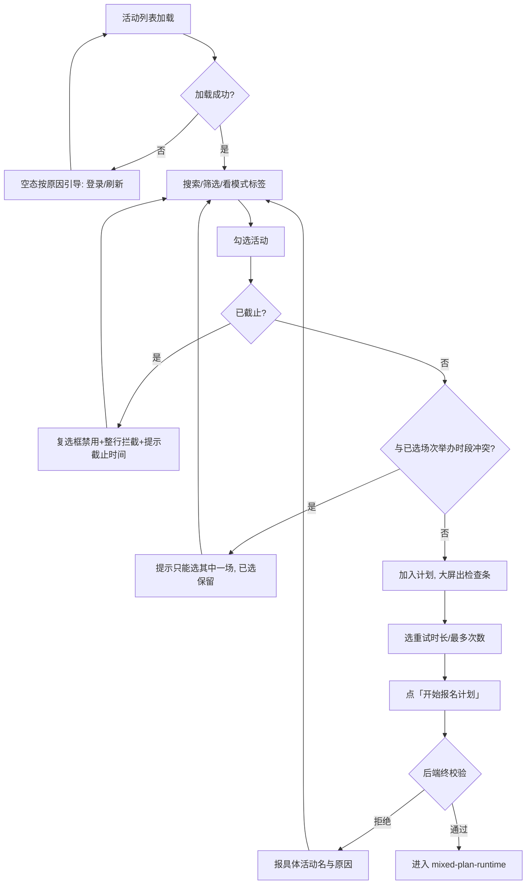

# 流程 · 选活动与开始计划

> 对应决策：[002 双模式](../decisions/002-signup-modes.md)、[003 重试策略](../decisions/003-retry-policy.md)、
> [004 多活动与冲突](../decisions/004-multi-activity-and-conflict.md)、[005 签到/签退筛选](../decisions/005-attendance-filters.md)

## 逐步说明

| # | 用户动作 | 系统状态 | 可见反馈 | 失败后的下一步 |
|---|---|---|---|---|
| 1 | 打开工具 / 点「刷新」 | 拉活动列表 | 时刻表按「正在开放 → 现在 → 今天/以后 → 待公布 → 刚截止 → 已报名」分组；顶部显示总数、可报名数、下一场开放 | 没登录 → 引导登录；连不上 → 引导刷新；空列表 → 「这里还没有活动」+ 刷新 |
| 2 | 搜索、切筛选 | 筛选只改可见行 | 关键词 + 状态（可报名/已报名/全部）+ 时间 + 排序 + 签到/签退三态筛选；偏好会记住 | 筛选没结果 → 「没有符合筛选的活动」+ 一键清除筛选 |
| 3 | 看行内标签 | 按 `sign_start`/`sign_end` 现算 | 每行标模式：**预报名**（未来开放）/ **立即报名·抢名额**（开放中）/ **已截止**；签到/签退未知显示「待说明」 | —— |
| 4 | 勾选一场 | 加入已选集合 | 大屏出检查条：登录撑不撑得到窗口、时钟准不准、是否 24 小时后才开放 | 已截止 → 复选框禁用、整行点击被拦；想选也选不了，提示带截止时间 |
| 5 | 再勾一场 | 跨批次冲突检查（全计划） | 不重叠 → 一起保留；重叠 → 提示「只能选其中一场」，已选保留不自动替换 | 换掉其中一场再看 |
| 6 | 选重试策略 | — | 「重试：2 分钟/10 分钟/30 分钟/1 小时/直到报名截止」+「最多次数（0=不限）」，默认 2 分钟+不限，会记住 | —— |
| 7 | 点「开始报名计划」 | 后端终校验（登录、截止、冲突、重复） | 计划摘要「已安排 N 场：X 场预报名等开放，Y 场立即报名马上执行」 | 校验拒绝 → 报具体活动名与原因（如「报名已截止」）；登录门禁未过 → 先回登录流程 |

## 关键边界

1. **筛选只影响可见行**：全局「下一场」、已选集合、冲突校验、任务执行全部基于全量数据——
   被筛掉的场次照样参与校验和执行，不会被筛选「藏丢」。
2. **已截止是五层一致拒绝**：复选框、整行点击、前端校验、后端校验、开始计划；只在「全部」里可看。
3. **开放优先**：有未报名的开放活动时，大屏目标场和快捷「选这一场」优先它，其次才是未来最近一场。
4. 签到/签退「需要/无需」筛选不显示未知（`null`）场次——宁可不显示，不误判成无需。
