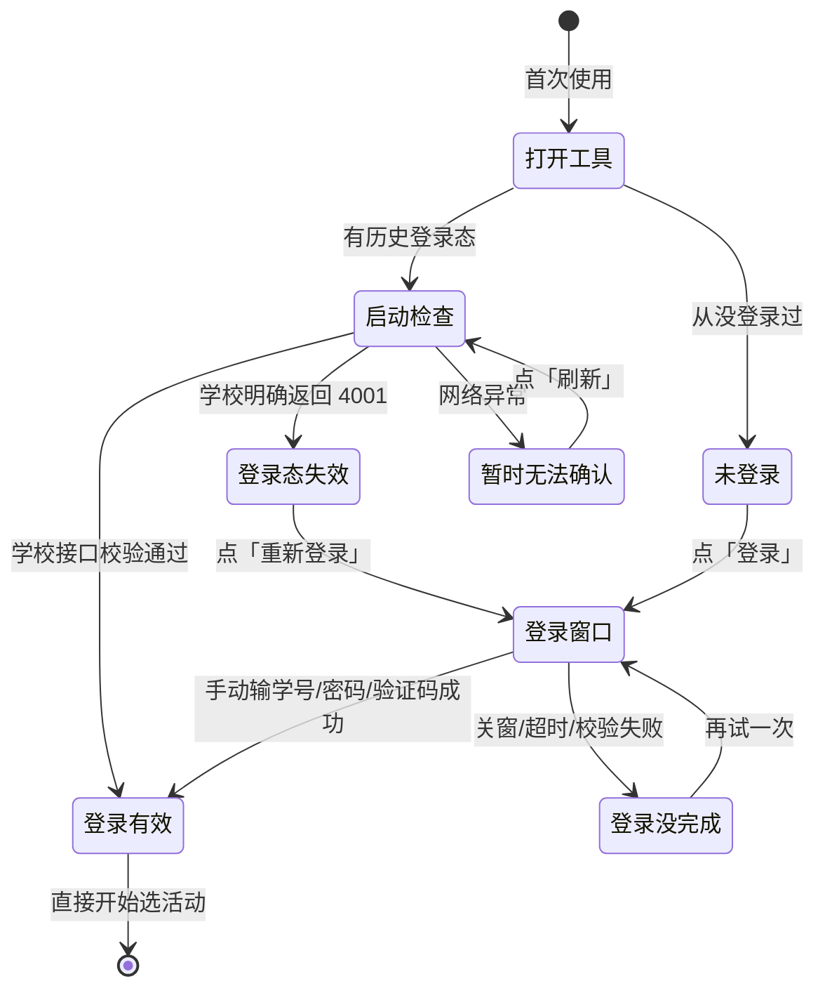

# 流程 · 首次使用与登录

> 对应决策：[001 命名](../decisions/001-product-naming.md)、[006 登录态持久化](../decisions/006-session-persistence.md)

## 逐步说明

| # | 用户动作 | 系统状态 | 可见反馈 | 失败后的下一步 |
|---|---|---|---|---|
| 1 | 双击打开工具 | 窗口启动，读取本地登录态 | 首次自动弹一次三步使用说明（右上角「使用说明」随时再开） | 窗口空白 → 装 WebView2 运行时（见 local/README 常见问题） |
| 2 | （无动作） | 没有登录态（`none`） | 胶囊「未登录」，主按钮「登录」，列表空态引导先登录 | —— |
| 3 | （无动作） | 有登录态，正在真实校验 | 胶囊「正在检查登录态」——**不得**提前显示「登录有效」 | —— |
| 4a | （无动作） | 校验通过（`valid`） | 胶囊「登录有效 · 约剩 N 小时」，提示「已复用本机登录态」，自动拉活动列表 | —— |
| 4b | （无动作） | 学校明确返回失效（`expired`） | 胶囊「登录态失效」，按钮「**重新登录**」 | 点「重新登录」走第 5 步 |
| 4c | （无动作） | 网络异常（`unknown`） | 胶囊「暂时无法确认登录态」；已有登录**保留**，不清、不逼重登 | 点「刷新」重试；网络恢复即回到 4a/4b |
| 5 | 点「登录」/「重新登录」 | 弹出真实 Chrome 登录窗 | 在 Chrome 里输学号、密码、图形验证码 | 打不开登录页 → 查校园网/代理；关窗或超时 → 结论「登录没完成」，可再试 |
| 6 | 在 Chrome 里点「立即登录」 | 脚本保存登录态并关窗 | 结论「登录好了 · 约 N 小时内有效」，列表自动刷新 | 登录后学校校验没过 → 结论「登录没完成」，再试一次 |
| 7 | 关闭工具再打开 | 复用同一数据根的登录态 | 先「正在检查登录态」，通过后「已复用本机登录态」——**不弹登录窗** | 只有真实 4001 才需要重登；EXE 替换、重建同理 |

## 文案边界（为什么有两个词）

- **首次使用显示「登录」；只有真实失效（4001）才显示「重新登录」**——两个词不混用，
  用户一眼知道是第一次还是续期。
- 「约剩 N 小时」永远是估算（实测约 10–17 小时区间），只作提醒不作拦截依据。

## 已知边界

- 真实 4001 重登、真实断网恢复、EXE 重开复用的真机复核留给用户（自动化证据是单测 + 模拟断网）。
