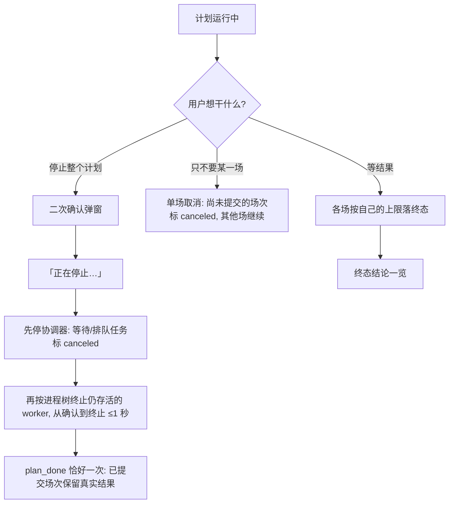

# 流程 · 停止、取消与结果

> 对应决策：[003 重试策略](../decisions/003-retry-policy.md)、[004 多活动与冲突](../decisions/004-multi-activity-and-conflict.md)、
> [006 登录态持久化](../decisions/006-session-persistence.md)

## 停止与取消

| # | 用户动作 | 系统状态 | 可见反馈 | 失败后的下一步 |
|---|---|---|---|---|
| 1 | 点「停止计划」 | 弹二次确认 | 说明会停掉什么（等待中的场不再报名） | 取消 → 回运行态 |
| 2 | 确认停止 | 协调器置停 → 进程树终止（`taskkill /F /T`，覆盖 onefile 引导的孙进程） | 立即「正在停止…」，保持锁定直到 `plan_done` 落地 | 停止是幂等的，重复点不报错不挂起 |
| 3 | （无动作） | 收尾 | 计划状态 `stopped`：**未提交场次 canceled，已提交场次保留真实结果**；停后一键把失败/取消场次重新选上 | —— |
| 4 | 对某一场点「取消」 | 单场取消（含等待中的场次） | 该场标 canceled，其他场照常 | —— |

## 终态结论一览

| 终态 | 怎么来的 | 界面结论 | 下一步 |
|---|---|---|---|
| 报名成功 | 学校返回成功 | 绿 ·「报名成功：活动名」 | 建议去活动页确认一眼 |
| 已经报过 | 查到已是报名状态 | 绿 ·「你已经报过这一场」 | 无需处理 |
| 达到最大提交次数 | 你设的次数用完 | 红 · 失败 + 停止条件「达到最大提交次数」 | 调大次数重新开始 |
| 重试时长到了 | 你设的时长用完 | 红 · 失败 +「重试时长到了」 | 调大时长重新开始 |
| 报名已截止 | `sign_end` 过了 | 红 · 失败 +「报名已截止」 | 这场结束，看下一场 |
| 登录失效 | 学校要求重登（4001） | 红 ·「登录失效」——**立即终态，重试没有意义** | 先「重新登录」 |
| 已停止 / 已取消 | 用户主动停 | 中性 · 不写「没抢到」 | 一键重选失败/取消场次 |
| 脚本异常退出 | worker 非预期退出 | 红 · 脚本异常退出 | 看运行记录里的原话排查 |

## 关键边界

1. **停止不会抹掉已提交场次的真实结果**——结论只按每场实际到达的终态写。
2. 失败结论必带到达的停止条件；失败后界面静默复查一次登录态与列表（不改写已展示的结论）。
3. 计划级状态：全部成功 `completed`；有成功有失败/取消 `partial`；全部失败 `failed`；用户停止 `stopped`。
