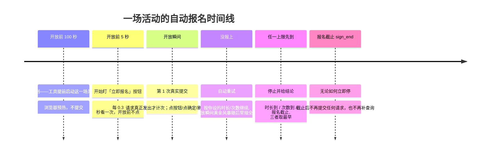
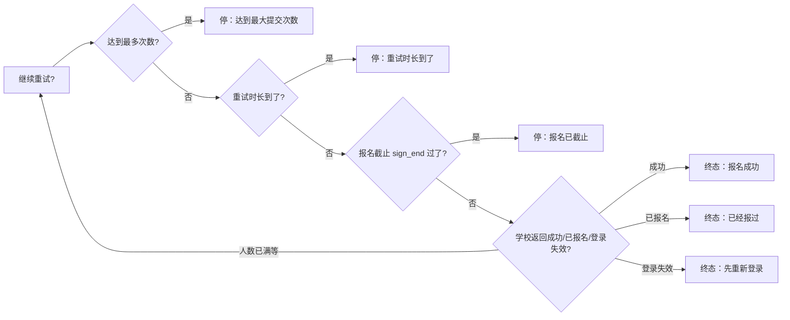

# 报名重试策略图解（RETRY_POLICY_GUIDE）

给普通使用者看的规则手册：工具在报名开放后会自动重试多久、重试几次、什么时候坚决停。
配套界面说明见 [../local/README.md](../local/README.md)；给开发者的契约在
[UI_SPEC.md](UI_SPEC.md) §5.8。**本工具只服务天软智慧校园单校账号**，不做多学校抽象。

---

## 一句话规则

**报名截止时间（sign_end）是硬上限；你设置的「重试时长」和「最多次数」谁先到谁停；
默认只重试 2 分钟、不限次数，不会默认挂两天。时长选「直到报名截止」时，截止就是唯一上限。**

## 报名窗口与重试时间线

**起算点分两种**：未来场次从学校原定开放时刻起算；已经开放的场次从「计划被接纳的
那一刻」起算——解包、鉴权、校时、开页花掉的时间都算在你设的时长里，页面加载慢
不会把截止整体后移。时长用单调时钟计，系统时间被回拨也不会变长。

**次数只认真正发出去的提交**：点了按钮但没点「确定」、确认框失败、页面刷新、
「是否已报名」查询都不计数。请求一发出就计一次并立刻上报，所以人数已满时你能
看到「已提交 1/3 次」在涨；如果最后一次请求发出后没有响应，结论是
「结果未确认，请到活动页核对」，不会替你断言没抢到——已发出的请求撤不回来。

时间线上的五个节点要分清哪些是**计划时间**、哪些是**实际事件**：

| 节点 | 来源 |
|---|---|
| 计划准备时刻 | 计划算出来的（原定开放前 100 秒），路线图不显示它当事件 |
| 本次启动 | worker 真正启动那一刻（实际事件时间） |
| 活动页已打开 | 详情页真正加载完成（实际事件时间；没发生就显示「待打开」） |
| 盯按钮 | 真正进入按钮监视（实际事件时间；没发生就显示「待发生」） |
| 原定开放 | 学校给的 `sign_start`，只是参考节点，不因提前准备而改变 |
| 本次重试到 | 重试截止=起算点+你设的时长，被 sign_end 截断 |

两点保证：

1. **界面只显示真实事件**：路线图上「活动页已打开」「盯按钮」没发生时显示「待打开 / 待发生」，
   不会拿计划时间或当前时间编一个看起来像发生过的时刻。
2. **慢页面不吃掉重试窗口**：重试起算点在打开页面前就固定了——已开放场次从 worker 启动
   时刻起算，页面加载慢几十秒，你设置的 10 分钟还是完整的 10 分钟。

三个上限的关系（取最早的那个）：

## 提交节奏：黄金风暴与 404 自适应（2026-10-28 修订）

报名开放瞬间的节奏分三段，按学校实际应答自动切换：

| 阶段 | 什么时候 | 节奏 | 说明 |
|---|---|---|---|
| **黄金风暴** | 开放后 0~1.6 秒 | 最多 10 轮，间隔 90ms | 开放瞬间冲一波；只要收到真实应答立即转入常规全速 |
| **常规全速** | 黄金之后 | 每 180ms 一轮 | 持续到时长/次数/截止任一先到 |
| **404 自适应** | 连续 3 次 404 | 1.6 倍指数退避，最多 3 秒 | 404 表示接口还没就绪或被限流；此时窗口自动扩到起点起 25 分钟，收到任何非 404 的真实应答立即切回全速 |

几条硬规则：

1. **sign_end 永远是硬截止**：25 分钟自适应扩窗也只能到 sign_end 为止，绝不越过报名截止。
2. **不承诺必抢到**：高频请求只是提高发出速度，不保证学校一定有名额。
3. **不隐藏重复提交**：每笔真实发出的 signUp 请求都有唯一编号并如实计数；一次动作发出多次也会按真实次数入账。
4. **未决不伪造成失败**：请求发出去但没拿到确定应答（断网、超时、读不出响应体），这笔一直算「未决」；停止时如实报「结果未确认，请到活动页核对」，不会替你断言没抢到。
5. **多笔未决合法**：黄金风暴期间可能有多笔请求在途，应答可以乱序回来，每笔按自己的编号结算。

三种「没报上」要分清：

| 现象 | 工具在做什么 | 你会看到的文案 |
|---|---|---|
| 按钮一直没出现 | 按退避节奏刷新页面，不点也不提交 | 「还没看到立即报名按钮」 |
| 活动已开放、正在准备 | 已进入详情页，等待第一次真实提交 | 立即模式「现在抢名额」；预报名在开放前显示「等待开放」 |
| 提交发出但没确定回应 | 可继续发（多笔未决），停止时保留次数 | 「结果待核对」+ 已提交次数 |

「提前 100 秒打开页面」只在**预报名**（原定开放时刻还没到）时成立；活动已经开放时
工具直接以本次启动时刻为起点立即抢名额，文案不会再写「提前打开」。

## 「第 N 次提交」是什么

- **只有真正点了「立即报名 → 确定」发起 signUp 请求，才计一次**；
- 页面刷新、等待、查「是不是已经报上了」**都不算**；
- 所以任务卡上的「已提交 3 次 · 报名人数已满」= 真的向学校交了 3 次；
- 设了次数上限时显示「已提交 2/3 次」；上限填 0（不限）时显示「已提交 3 次（不限次数）」。
  这个分母是你设的策略，不是学校的名额总数。

## 点「停止」到底停什么

停止只结束**本机这一场的执行**，不会撤销已经发给学校的请求，也不会推翻已经收到的答复：

| 停止时已经发生的事 | 你会看到的结论 |
|---|---|
| 学校已经明确回了「报名成功 / 已报名」 | 仍是成功 / 已经报过——停止晚到不改写结论 |
| 学校已经明确回了失败（名额满、已截止…） | 仍是那个确定原因，不会降级成「待核对」 |
| 请求发出去了，但没等到回应 | 「待核对」+ 实际提交次数；本轮不再自动重发 |
| 一次都没提交，只是本地在等 | 普通取消 |

所以「本机已停止」和「学校那边结果待核对」是**可以同时成立**的两件事，界面会并列写清楚。
F5 重载只恢复显示，不会因此自动重新开始，也不会重新提交。

## 结果待核对：为什么结论不替你猜

如果请求已经发出去，但没等到学校明确应答（断网、页面被关、进程被系统收走），
结论只能是**「报名结果待核对」**：

- 已发出的请求撤不回来，工具不会替你断言「没抢到」；
- 任务卡会写「已提交 N 次，没有拿到确定回应」，计划总结把它单列成「待核对」；
- 黄金风暴期间可以有多笔在途请求，每笔都按真实次数入账，停止时如实报未决笔数；
- 下一步是你自己打开学校活动页核对；确认没报上，再重新开始一次计划。

同类但不同的还有**「登录态暂时无法确认」**：这是网络/接口没应答，不是登录过期。
工具不会让你重新登录，只提示检查网络后刷新。

## 正常结束和异常结束的区别

| 情况 | 你看到的结论 |
|---|---|
| 到达你设的时长/次数，或报名截止 | 「重试时长到了 / 达到最大提交次数 / 报名已截止」+ 学校最近原因 |
| 学校明确返回成功/已报名 | 「报名成功 / 已经报过」 |
| 进程被系统收走、输出中断，但已发过请求 | 「结果待核对」+ 实际提交次数 |
| 你点了「停止」，但之前已经发过请求 | 「计划已停止」+「N 场待核对」并列，次数保留 |
| 本机组件异常，一次都没发出去 | 「本机流程异常结束」——不代表学校拒绝 |
| 校时不可用，一次都没发出去 | 「北京时间在开始前失去校准，这次没有启动」——**本机本地停止**，不是学校拒绝；恢复校时后可重新开始 |
| 校时在运行中失效 | 计划收成唯一终态（canceled，原因「北京时间暂不可用」）；已提交未决保留「待核对」与次数，不自动重发；已确认的报名结果不变 |

## 两个设置怎么选

| 场景 | 重试时长 | 最多次数 | 为什么 |
|---|---|---|---|
| 热门活动拼手速（默认） | 2 分钟 | 0（不限） | 开放头两分钟定胜负，别多挂 |
| 知道会有人退名额 | 10–30 分钟 | 0 | 有人取消就轮到你，低频轮询不刷爆接口 |
| 独苗名额，赌到最后一刻 | 直到报名截止 | 0 | 一直低频等到 sign_end 硬截止 |
| 只想试几次就走 | 2 分钟 | 3 | 报 3 次没上就撤，不恋战 |

注意两点：

1. **「直到报名截止」只在活动公布了截止时间（sign_end）时生效**；学校没给截止时间的活动会自动回退成 2 分钟，不会无限运行。
2. 长窗口期间电脑要**保持唤醒、别断网**；合盖睡眠会错过重试。

## 真实案例

> 「网络安全·数字时代大长城」周五 00:59:59 开放、周六 23:59:59 截止（sign_end）。
> 你选了「10 分钟 + 不限次数」：
>
> - 00:59:59 第 1 次提交：`code:0 报名人数已满` —— 满了，可重试，按黄金风暴/常规全速节奏继续；
> - 01:03:41 第 9 次提交：`code:1 成功` —— 9 次提交、耗时约 4 分钟，终态「报名成功」；
> - 假如一直满员，01:09:59（开放+10 分钟）一到就停，终态写「重试时长到了」。
>   选「直到报名截止」才会继续低频挂到周六 23:59:59。

> 「程序设计实验室开放日」没公布截止时间，你选了「直到报名截止」：
> 工具发现没有 sign_end，自动按 2 分钟窗口执行并在日志里说明——宁可少试，不无限跑。

## 终态一览

| 终态 | 含义 | 下一步 |
|---|---|---|
| 报名成功 | 学校返回 code:1 | 去活动页确认一眼 |
| 已经报过 | 查到已是报名状态 | 无需处理 |
| 登录失效 | 学校要求重新登录（4001） | 先点「重新登录」，重试没有意义 |
| 达到最大提交次数 | 你设的次数用完 | 想继续就调大次数重新开始 |
| 重试时长到了 | 你设的时长用完 | 想继续就调大时长重新开始 |
| 报名已截止 | sign_end 过了 | 这场结束了，看下一场 |
| 已停止 | 你点了停止计划 | 可一键把失败场次重新选上 |
| 脚本异常退出 | worker 非预期退出 | 看运行记录里的原话排查 |

## 决策 012 修订：起点与截止按工具北京时间（2026-10-26 返修轮更新）

图中的实际起点/截止按**工具的独立北京时间**计（公共 NTP 锚点 + 经过时长），不随系统墙钟回拨延长；持续时长按经过时长收紧。次数仍只数真实提交、未决请求不自动重发；校时不可用时自动报名禁启或停止自动动作，已提交未决保留「待核对」。时间不会因系统时间变化而延长：错时/回拨只影响本机墙钟读数，不影响你设的时长与学校截止。校时不可用是**本机本地停止**，结论里不说成「学校拒绝」。
