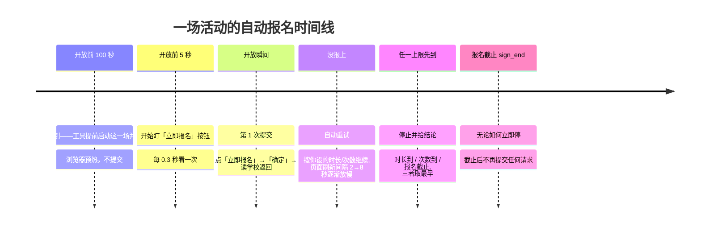
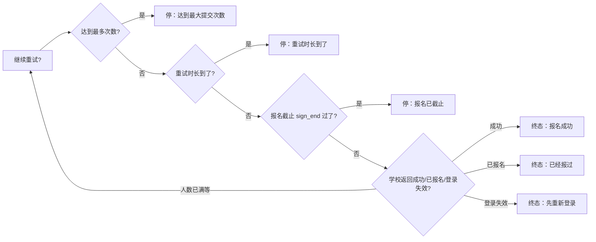

# 报名重试策略图解（RETRY_POLICY_GUIDE）

给普通使用者看的规则手册：工具在报名开放后会自动重试多久、重试几次、什么时候坚决停。
配套界面说明见 [../local/README.md](../local/README.md)；给开发者的契约在
[UI_SPEC.md](UI_SPEC.md) §5.8。**本工具只服务天软智慧校园单校账号**，不做多学校抽象。

---

## 一句话规则

**报名截止时间（sign_end）是硬上限；你设置的「重试时长」和「最多次数」谁先到谁停；
默认只重试 2 分钟、不限次数，不会默认挂两天。**

## 报名窗口与重试时间线

时间线上的五个节点要分清哪些是**计划时间**、哪些是**实际事件**：

| 节点 | 来源 |
|---|---|
| 计划准备时刻 | 计划算出来的（原定开放前 100 秒），路线图不显示它当事件 |
| 本次启动 | worker 真正启动那一刻（实际事件时间） |
| 活动页已打开 | 详情页真正加载完成（实际事件时间；没发生就显示「待打开」） |
| 盯按钮 | 真正进入按钮监视（实际事件时间；没发生就显示「待发生」） |
| 原定开放 | 学校给的 `sign_start`，只是参考节点，不因提前准备而改变 |
| 本次重试到 | 重试截止=起算点+你设的时长，被 sign_end 截断 |

两点保证：

1. **界面只显示真实事件**：路线图上「活动页已打开」「盯按钮」没发生时显示「待打开 / 待发生」，
   不会拿计划时间或当前时间编一个看起来像发生过的时刻。
2. **慢页面不吃掉重试窗口**：重试起算点在打开页面前就固定了——已开放场次从 worker 启动
   时刻起算，页面加载慢几十秒，你设置的 10 分钟还是完整的 10 分钟。

三个上限的关系（取最早的那个）：

## 「第 N 次提交」是什么

- **只有真正点了「立即报名 → 确定」发起 signUp 请求，才计一次**；
- 页面刷新、等待、查「是不是已经报上了」**都不算**；
- 所以任务卡上的「第 3 次提交 · 报名人数已满」= 真的向学校交了 3 次。
  界面不显示「3/10」这种总次数——上限是你设的策略，报满之前谁也不知道总数。

## 两个设置怎么选

| 场景 | 重试时长 | 最多次数 | 为什么 |
|---|---|---|---|
| 热门活动拼手速（默认） | 2 分钟 | 0（不限） | 开放头两分钟定胜负，别多挂 |
| 知道会有人退名额 | 10–30 分钟 | 0 | 有人取消就轮到你，低频轮询不刷爆接口 |
| 独苗名额，赌到最后一刻 | 直到报名截止 | 0 | 一直低频等到 sign_end 硬截止 |
| 只想试几次就走 | 2 分钟 | 3 | 报 3 次没上就撤，不恋战 |

注意两点：

1. **「直到报名截止」只在活动公布了截止时间（sign_end）时生效**；学校没给截止时间的活动会自动回退成 2 分钟，不会无限运行。
2. 长窗口期间电脑要**保持唤醒、别断网**；合盖睡眠会错过重试。

## 真实案例

> 「网络安全·数字时代大长城」周五 00:59:59 开放、周六 23:59:59 截止（sign_end）。
> 你选了「10 分钟 + 不限次数」：
>
> - 00:59:59 第 1 次提交：`code:0 报名人数已满` —— 满了，可重试，页面刷新间隔 2→8 秒慢慢放；
> - 01:03:41 第 9 次提交：`code:1 成功` —— 9 次提交、耗时约 4 分钟，终态「报名成功」；
> - 假如一直满员，01:09:59（开放+10 分钟）一到就停，终态写「重试时长到了」。
>   选「直到报名截止」才会继续低频挂到周六 23:59:59。

> 「程序设计实验室开放日」没公布截止时间，你选了「直到报名截止」：
> 工具发现没有 sign_end，自动按 2 分钟窗口执行并在日志里说明——宁可少试，不无限跑。

## 终态一览

| 终态 | 含义 | 下一步 |
|---|---|---|
| 报名成功 | 学校返回 code:1 | 去活动页确认一眼 |
| 已经报过 | 查到已是报名状态 | 无需处理 |
| 登录失效 | 学校要求重新登录（4001） | 先点「重新登录」，重试没有意义 |
| 达到最大提交次数 | 你设的次数用完 | 想继续就调大次数重新开始 |
| 重试时长到了 | 你设的时长用完 | 想继续就调大时长重新开始 |
| 报名已截止 | sign_end 过了 | 这场结束了，看下一场 |
| 已停止 | 你点了停止计划 | 可一键把失败场次重新选上 |
| 脚本异常退出 | worker 非预期退出 | 看运行记录里的原话排查 |
